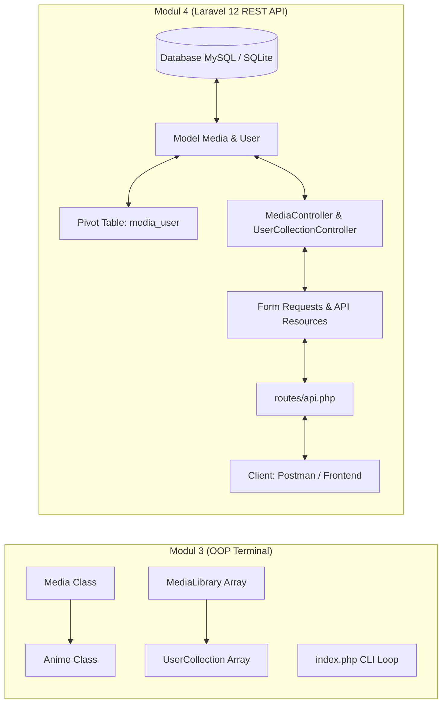

# Panduan Lengkap Pengerjaan Demo Modul 4: REST API FlipPlay (Laravel 12)

Dokumen ini merupakan panduan langkah demi langkah (*step-by-step guide*) untuk menyelesaikan **Demo Modul 4 Praktikum Pemrograman Web**. Panduan ini dirancang agar proyek Anda memenuhi seluruh instruksi dan memperoleh nilai maksimal (100% pada porsi Demo 80%) sesuai rubrik penilaian resmi.

---

## 📋 Tabel Pemetaan Rubrik Penilaian

| Komponen Penilaian | Bobot | Target Implementasi di Proyek |
| :--- | :---: | :--- |
| **CRUD API Lengkap** | **20%** | Controller `MediaController` dengan method `index`, `show`, `store`, `update`, `destroy` beserta HTTP Status Code yang tepat (`200 OK`, `201 Created`, `204 No Content` / `200`). |
| **Eloquent Relationship** | **20%** | Migrasi tabel `users`, `media`, dan pivot table `media_user`. Definisi relasi Many-to-Many (`belongsToMany`) serta penerapan **Eager Loading** (`with()` / `load()`) untuk menghindari masalah N+1 Query. |
| **Form Request & Error 422** | **15%** | Validasi input terpisah menggunakan `StoreMediaRequest` dan `UpdateMediaRequest`. Validasi judul unik, tipe data tepat, serta penanganan otomatis status `422 Unprocessable Entity`. |
| **API Resource** | **10%** | Standardisasi format JSON response menggunakan `MediaResource` dan `UserResource`, termasuk pemanfaatan method `$this->whenLoaded(...)`. |
| **Custom Action di luar CRUD** | **10%** | Endpoint khusus pengelolaan relasi: Tambah media ke koleksi pengguna (`attach`), lihat koleksi pengguna, dan hapus media dari koleksi pengguna (`detach`). |
| **Pengujian Endpoint (Postman)**| **5%** | Pengujian lengkap mencakup **Happy Path** (skenario sukses) dan **Failure Path** (skenario error/validasi gagal) menggunakan Postman. |
| **TOTAL NILAI DEMO** | **80%** | *(20% sisa biasanya berasal dari kehadiran/laporan praktikum)* |

---

## 🏛️ Arsitektur Transformasi: Modul 3 ke Modul 4



---

## TAHAP 1: Inisialisasi Proyek & Konfigurasi Laravel 12

### 1.1 Persiapan Sistem
Pastikan perangkat Anda sudah terinstal:
* PHP >= 8.2
* Composer
* Database Server (MySQL / MariaDB via XAMPP/Laragon, atau SQLite)
* Git
* Postman

### 1.2 Buat Proyek Laravel 12 & Setup Repository Git
Buka terminal pada direktori yang diinginkan:

```bash
# 1. Buat proyek Laravel baru
composer create-project laravel/laravel flipplay-api

# 2. Masuk ke direktori proyek
cd flipplay-api

# 3. Inisialisasi Git & hubungkan ke GitHub
git init
git add .
git commit -m "feat: inisialisasi proyek laravel 12 flipplay-api"
git branch -M main
# Ganti URL berikut dengan URL repositori GitHub Anda:
# git remote add origin https://github.com/USERNAME/flipplay-api.git
# git push -u origin main
```

### 1.3 Install API Route (Fitur Khusus Laravel 11 & 12)
> [!IMPORTANT]
> Pada Laravel 11 dan 12, file `routes/api.php` tidak dibuat secara default. Anda wajib menjalankan perintah berikut:

```bash
php artisan install:api
```
Perintah ini akan membuat file `routes/api.php` dan mengaktifkan middleware API pada konfigurasi aplikasi (`bootstrap/app.php`).

### 1.4 Konfigurasi Database (`.env`)
Buka file `.env` di root proyek dan sesuaikan koneksi database (contoh menggunakan MySQL):

```env
DB_CONNECTION=mysql
DB_HOST=127.0.0.1
DB_PORT=3306
DB_DATABASE=flipplay_db
DB_USERNAME=root
DB_PASSWORD=
```
*Pastikan database `flipplay_db` sudah dibuat di MySQL/phpMyAdmin.*

---

## TAHAP 2: Database & Migrations (Nilai: 20%)

Pada tahap ini kita membuat struktur tabel:
1. `users` (tabel bawaan Laravel)
2. `media` (katalog media)
3. `media_user` (pivot table relasi Many-to-Many antara user dan media)

### 2.1 Buat Migration untuk Tabel `media`
Jalankan perintah:
```bash
php artisan make:migration create_media_table
```

Buka file migrasi di `database/migrations/xxxx_xx_xx_create_media_table.php`, lalu modifikasi:

```php
<?php

use Illuminate\Database\Migrations\Migration;
use Illuminate\Database\Schema\Blueprint;
use Illuminate\Support\Facades\Schema;

return new class extends Migration
{
    public function up(): void
    {
        Schema::create('media', function (Blueprint $table) {
            $table->id();
            $table->string('title')->unique();
            $table->string('type')->default('Anime'); // Anime, Movie, Series, dsb.
            $table->string('genre');
            $table->enum('status', ['Ongoing', 'Finished'])->default('Ongoing');
            $table->integer('episodes')->default(1);
            $table->decimal('score', 3, 1)->default(0.0);
            $table->timestamps();
        });
    }

    public function down(): void
    {
        Schema::dropIfExists('media');
    }
};
```

### 2.2 Buat Migration untuk Pivot Table `media_user`
Jalankan perintah:
```bash
php artisan make:migration create_media_user_table
```

Buka file migrasi di `database/migrations/xxxx_xx_xx_create_media_user_table.php`:

```php
<?php

use Illuminate\Database\Migrations\Migration;
use Illuminate\Database\Schema\Blueprint;
use Illuminate\Support\Facades\Schema;

return new class extends Migration
{
    public function up(): void
    {
        Schema::create('media_user', function (Blueprint $table) {
            $table->id();
            $table->foreignId('user_id')->constrained('users')->cascadeOnDelete();
            $table->foreignId('media_id')->constrained('media')->cascadeOnDelete();
            $table->timestamps();

            // Mencegah duplikasi: 1 user tidak boleh menyimpan media yang sama 2 kali
            $table->unique(['user_id', 'media_id']);
        });
    }

    public function down(): void
    {
        Schema::dropIfExists('media_user');
    }
};
```

### 2.3 Jalankan Migrasi
```bash
php artisan migrate
```

---

## TAHAP 3: Eloquent Models & Relasi (Nilai: 20%)

### 3.1 Model `Media`
Buat model `Media`:
```bash
php artisan make:model Media
```

Edit file `app/Models/Media.php`:

```php
<?php

namespace App\Models;

use Illuminate\Database\Eloquent\Factories\HasFactory;
use Illuminate\Database\Eloquent\Model;
use Illuminate\Database\Eloquent\Relations\BelongsToMany;

class Media extends Model
{
    use HasFactory;

    protected $table = 'media';

    protected $fillable = [
        'title',
        'type',
        'genre',
        'status',
        'episodes',
        'score',
    ];

    protected $casts = [
        'episodes' => 'integer',
        'score' => 'float',
    ];

    /**
     * Relasi Many-to-Many ke User (kolektor media ini)
     */
    public function users(): BelongsToMany
    {
        return $this->belongsToMany(User::class, 'media_user')->withTimestamps();
    }
}
```

### 3.2 Update Model `User`
Buka file `app/Models/User.php`, tambahkan relasi Many-to-Many ke model `Media`:

```php
use App\Models\Media;
use Illuminate\Database\Eloquent\Relations\BelongsToMany;

// Di dalam class User:
public function media(): BelongsToMany
{
    return $this->belongsToMany(Media::class, 'media_user')->withTimestamps();
}
```

### 3.3 Database Seeder (Mempermudah Pengujian Saat Demo)
Buat seeder untuk mengisi data awal:
```bash
php artisan make:seeder DatabaseSeeder
```

Modifikasi `database/seeders/DatabaseSeeder.php`:

```php
<?php

namespace Database\Seeders;

use App\Models\Media;
use App\Models\User;
use Illuminate\Database\Seeder;
use Illuminate\Support\Facades\Hash;

class DatabaseSeeder extends Seeder
{
    public function run(): void
    {
        // 1. Buat User Contoh
        $user1 = User::create([
            'name' => 'Naufal',
            'email' => 'naufal@example.com',
            'password' => Hash::make('password123'),
        ]);

        $user2 = User::create([
            'name' => 'OtakuUser',
            'email' => 'otaku@example.com',
            'password' => Hash::make('password123'),
        ]);

        // 2. Data Media (dari Modul 3)
        $m1 = Media::create([
            'title' => 'Frieren: Beyond Journey\'s End',
            'type' => 'Anime',
            'genre' => 'Adventure, Fantasy',
            'status' => 'Finished',
            'episodes' => 28,
            'score' => 9.3,
        ]);

        $m2 = Media::create([
            'title' => 'Attack on Titan',
            'type' => 'Anime',
            'genre' => 'Action, Drama',
            'status' => 'Finished',
            'episodes' => 89,
            'score' => 9.0,
        ]);

        $m3 = Media::create([
            'title' => 'Jujutsu Kaisen',
            'type' => 'Anime',
            'genre' => 'Action, Supernatural',
            'status' => 'Ongoing',
            'episodes' => 47,
            'score' => 8.6,
        ]);

        $m4 = Media::create([
            'title' => 'Steins;Gate',
            'type' => 'Anime',
            'genre' => 'Sci-Fi, Thriller',
            'status' => 'Finished',
            'episodes' => 24,
            'score' => 9.1,
        ]);

        // 3. Tambahkan ke koleksi user contoh
        $user1->media()->attach([$m1->id, $m2->id]);
    }
}
```

Jalankan seeder:
```bash
php artisan db:seed
```

---

## TAHAP 4: Form Request Validation (Nilai: 15%)

Sesuai rubrik penilaian, endpoint input (POST/PUT/PATCH) wajib menggunakan **Form Request Validation** yang otomatis menghasilkan status `422 Unprocessable Entity` saat validasi gagal.

### 4.1 Request untuk Tambah Media (`StoreMediaRequest`)
Jalankan:
```bash
php artisan make:request StoreMediaRequest
```

Buka `app/Http/Requests/StoreMediaRequest.php`:

```php
<?php

namespace App\Http\Requests;

use Illuminate\Foundation\Http\FormRequest;

class StoreMediaRequest extends FormRequest
{
    public function authorize(): bool
    {
        return true; // Izinkan semua request untuk demo publik
    }

    public function rules(): array
    {
        return [
            'title' => 'required|string|max:255|unique:media,title',
            'type' => 'nullable|string|max:50',
            'genre' => 'required|string|max:255',
            'status' => 'required|in:Ongoing,Finished',
            'episodes' => 'required|integer|min:1',
            'score' => 'required|numeric|between:0,10',
        ];
    }

    public function messages(): array
    {
        return [
            'title.required' => 'Judul media wajib diisi.',
            'title.unique' => 'Judul media sudah ada di dalam sistem.',
            'status.in' => 'Status hanya boleh bernilai "Ongoing" atau "Finished".',
            'score.between' => 'Skor harus berada pada rentang 0.0 sampai 10.0.',
        ];
    }
}
```

### 4.2 Request untuk Ubah Media (`UpdateMediaRequest`)
Jalankan:
```bash
php artisan make:request UpdateMediaRequest
```

Buka `app/Http/Requests/UpdateMediaRequest.php`:

```php
<?php

namespace App\Http\Requests;

use Illuminate\Foundation\Http\FormRequest;
use Illuminate\Validation\Rule;

class UpdateMediaRequest extends FormRequest
{
    public function authorize(): bool
    {
        return true;
    }

    public function rules(): array
    {
        $mediaId = $this->route('medium') ?? $this->route('media');
        $id = is_object($mediaId) ? $mediaId->id : $mediaId;

        return [
            'title' => [
                'sometimes',
                'required',
                'string',
                'max:255',
                Rule::unique('media', 'title')->ignore($id),
            ],
            'type' => 'nullable|string|max:50',
            'genre' => 'sometimes|required|string|max:255',
            'status' => 'sometimes|required|in:Ongoing,Finished',
            'episodes' => 'sometimes|required|integer|min:1',
            'score' => 'sometimes|required|numeric|between:0,10',
        ];
    }

    public function messages(): array
    {
        return [
            'title.unique' => 'Judul media sudah digunakan oleh data lain.',
            'status.in' => 'Status hanya boleh bernilai "Ongoing" atau "Finished".',
            'score.between' => 'Skor harus bernilai antara 0.0 sampai 10.0.',
        ];
    }
}
```

---

## TAHAP 5: API Resource (Nilai: 10%)

API Resource memastikan format JSON selalu konsisten dan field relasi hanya dimuat ketika diperlukan (`whenLoaded`).

### 5.1 Buat `MediaResource` dan `UserResource`
```bash
php artisan make:resource MediaResource
php artisan make:resource UserResource
```

### 5.2 Edit `app/Http/Resources/UserResource.php`
```php
<?php

namespace App\Http\Resources;

use Illuminate\Http\Request;
use Illuminate\Http\Resources\Json\JsonResource;

class UserResource extends JsonResource
{
    public function toArray(Request $request): array
    {
        return [
            'id' => $this->id,
            'name' => $this->name,
            'email' => $this->email,
            'media_collection' => MediaResource::collection($this->whenLoaded('media')),
            'created_at' => $this->created_at?->toISOString(),
        ];
    }
}
```

### 5.3 Edit `app/Http/Resources/MediaResource.php`
```php
<?php

namespace App\Http\Resources;

use Illuminate\Http\Request;
use Illuminate\Http\Resources\Json\JsonResource;

class MediaResource extends JsonResource
{
    public function toArray(Request $request): array
    {
        return [
            'id' => $this->id,
            'title' => $this->title,
            'type' => $this->type,
            'genre' => $this->genre,
            'status' => $this->status,
            'episodes' => $this->episodes,
            'score' => (float) $this->score,
            // Relasi ditampilkan secara dinamis jika di-load menggunakan eager loading
            'collected_by_users' => UserResource::collection($this->whenLoaded('users')),
            'created_at' => $this->created_at?->toISOString(),
            'updated_at' => $this->updated_at?->toISOString(),
        ];
    }
}
```

---

## TAHAP 6: Controller CRUD & Custom Action (Nilai: 20% + 10%)

### 6.1 `MediaController` (CRUD Standar)
Buat controller:
```bash
php artisan make:controller Api/MediaController
```

Buka `app/Http/Controllers/Api/MediaController.php`:

```php
<?php

namespace App\Http\Controllers\Api;

use App\Http\Controllers\Controller;
use App\Http\Requests\StoreMediaRequest;
use App\Http\Requests\UpdateMediaRequest;
use App\Http\Resources\MediaResource;
use App\Models\Media;
use Illuminate\Http\JsonResponse;
use Illuminate\Http\Request;

class MediaController extends Controller
{
    /**
     * GET /api/media
     * Menampilkan daftar seluruh media (mendukung filter pencarian ?title=...)
     */
    public function index(Request $request): JsonResponse
    {
        $query = Media::query();

        // Query filter pencarian berdasarkan judul
        if ($request->has('title') && !empty($request->query('title'))) {
            $query->where('title', 'like', '%' . $request->query('title') . '%');
        }

        // Opsional: eager load users jika parameter include_users=true
        if ($request->boolean('include_users')) {
            $query->with('users');
        }

        $mediaList = $query->orderBy('id', 'desc')->get();

        return response()->json([
            'success' => true,
            'message' => 'Daftar media berhasil diambil.',
            'data' => MediaResource::collection($mediaList),
        ], 200);
    }

    /**
     * POST /api/media
     * Menambahkan media baru (Status Code: 201 Created)
     */
    public function store(StoreMediaRequest $request): JsonResponse
    {
        $media = Media::create($request->validated());

        return response()->json([
            'success' => true,
            'message' => 'Media berhasil ditambahkan ke library.',
            'data' => new MediaResource($media),
        ], 201);
    }

    /**
     * GET /api/media/{id}
     * Menampilkan detail media beserta user yang mengoleksinya (Eager Loading)
     */
    public function show(int $id): JsonResponse
    {
        $media = Media::with('users')->find($id);

        if (!$media) {
            return response()->json([
                'success' => false,
                'message' => "Media dengan ID {$id} tidak ditemukan.",
            ], 404);
        }

        return response()->json([
            'success' => true,
            'message' => 'Detail media berhasil ditemukan.',
            'data' => new MediaResource($media),
        ], 200);
    }

    /**
     * PUT/PATCH /api/media/{id}
     * Mengupdate data media
     */
    public function update(UpdateMediaRequest $request, int $id): JsonResponse
    {
        $media = Media::find($id);

        if (!$media) {
            return response()->json([
                'success' => false,
                'message' => "Media dengan ID {$id} tidak ditemukan.",
            ], 404);
        }

        $media->update($request->validated());

        return response()->json([
            'success' => true,
            'message' => 'Data media berhasil diperbarui.',
            'data' => new MediaResource($media),
        ], 200);
    }

    /**
     * DELETE /api/media/{id}
     * Menghapus media dari katalog
     */
    public function destroy(int $id): JsonResponse
    {
        $media = Media::find($id);

        if (!$media) {
            return response()->json([
                'success' => false,
                'message' => "Media dengan ID {$id} tidak ditemukan.",
            ], 404);
        }

        $media->delete();

        return response()->json([
            'success' => true,
            'message' => "Media '{$media->title}' berhasil dihapus dari library.",
        ], 200);
    }
}
```

### 6.2 `UserCollectionController` (Custom Action: Koleksi Media)
Controller ini menangani **Custom Action** relasi pivot table:
* Melihat koleksi pengguna
* Menambahkan media ke koleksi (`attach`)
* Menghapus media dari koleksi (`detach`)

Buat controller:
```bash
php artisan make:controller Api/UserCollectionController
```

Buka `app/Http/Controllers/Api/UserCollectionController.php`:

```php
<?php

namespace App\Http\Controllers\Api;

use App\Http\Controllers\Controller;
use App\Http\Resources\MediaResource;
use App\Models\Media;
use App\Models\User;
use Illuminate\Http\JsonResponse;
use Illuminate\Http\Request;

class UserCollectionController extends Controller
{
    /**
     * GET /api/users/{userId}/collection
     * Menampilkan daftar koleksi media milik pengguna
     */
    public function index(int $userId): JsonResponse
    {
        $user = User::with('media')->find($userId);

        if (!$user) {
            return response()->json([
                'success' => false,
                'message' => "Pengguna dengan ID {$userId} tidak ditemukan.",
            ], 404);
        }

        return response()->json([
            'success' => true,
            'message' => "Koleksi media milik {$user->name} berhasil diambil.",
            'user' => [
                'id' => $user->id,
                'name' => $user->name,
            ],
            'data' => MediaResource::collection($user->media),
        ], 200);
    }

    /**
     * POST /api/users/{userId}/collection
     * Menambahkan media ke koleksi pengguna (Custom Action Attach)
     */
    public function store(Request $request, int $userId): JsonResponse
    {
        $request->validate([
            'media_id' => 'required|integer|exists:media,id',
        ], [
            'media_id.required' => 'ID media wajib disertakan.',
            'media_id.exists' => 'Media yang dipilih tidak terdaftar di sistem.',
        ]);

        $user = User::find($userId);
        if (!$user) {
            return response()->json([
                'success' => false,
                'message' => "Pengguna dengan ID {$userId} tidak ditemukan.",
            ], 404);
        }

        $mediaId = (int) $request->input('media_id');
        $media = Media::find($mediaId);

        // Validasi: Cek apakah media sudah ada dalam koleksi user (mencegah duplikasi)
        if ($user->media()->where('media_id', $mediaId)->exists()) {
            return response()->json([
                'success' => false,
                'message' => "Media '{$media->title}' sudah ada di koleksi pengguna ini.",
            ], 422);
        }

        // Attach relasi ke pivot table
        $user->media()->attach($mediaId);

        return response()->json([
            'success' => true,
            'message' => "Berhasil menambahkan '{$media->title}' ke koleksi {$user->name}.",
            'data' => new MediaResource($media),
        ], 201);
    }

    /**
     * DELETE /api/users/{userId}/collection/{mediaId}
     * Menghapus media dari koleksi pengguna (Custom Action Detach)
     */
    public function destroy(int $userId, int $mediaId): JsonResponse
    {
        $user = User::find($userId);
        if (!$user) {
            return response()->json([
                'success' => false,
                'message' => "Pengguna dengan ID {$userId} tidak ditemukan.",
            ], 404);
        }

        // Cek apakah media ada di koleksi user
        if (!$user->media()->where('media_id', $mediaId)->exists()) {
            return response()->json([
                'success' => false,
                'message' => "Media ID {$mediaId} tidak ditemukan dalam koleksi {$user->name}.",
            ], 404);
        }

        // Detach relasi
        $user->media()->detach($mediaId);

        return response()->json([
            'success' => true,
            'message' => "Berhasil menghapus media ID {$mediaId} dari koleksi {$user->name}.",
        ], 200);
    }
}
```

---

## TAHAP 7: Routing API (`routes/api.php`)

Buka file `routes/api.php` dan daftarkan endpoint sebagai berikut:

```php
<?php

use App\Http\Controllers\Api\MediaController;
use App\Http\Controllers\Api\UserCollectionController;
use Illuminate\Support\Facades\Route;

/*
|--------------------------------------------------------------------------
| FlipPlay REST API Routes
|--------------------------------------------------------------------------
*/

// 1. CRUD Media (index, store, show, update, destroy)
Route::apiResource('media', MediaController::class);

// 2. Custom Action: Koleksi Pengguna (Attach, Get Collection, Detach)
Route::prefix('users/{user}/collection')->group(function () {
    Route::get('/', [UserCollectionController::class, 'index'])->name('users.collection.index');
    Route::post('/', [UserCollectionController::class, 'store'])->name('users.collection.store');
    Route::delete('/{media}', [UserCollectionController::class, 'destroy'])->name('users.collection.destroy');
});
```

### Verifikasi Routing
Jalankan perintah ini di terminal untuk memastikan seluruh route terdaftar dengan benar:
```bash
php artisan route:list --path=api
```

Output yang diharapkan:
* `GET|HEAD   api/media` ➔ `media.index`
* `POST       api/media` ➔ `media.store`
* `GET|HEAD   api/media/{medium}` ➔ `media.show`
* `PUT|PATCH  api/media/{medium}` ➔ `media.update`
* `DELETE     api/media/{medium}` ➔ `media.destroy`
* `GET|HEAD   api/users/{user}/collection` ➔ `users.collection.index`
* `POST       api/users/{user}/collection` ➔ `users.collection.store`
* `DELETE     api/users/{user}/collection/{media}` ➔ `users.collection.destroy`

---

## TAHAP 8: Pengujian Endpoint di Postman (Nilai: 5%)

Jalankan web server Laravel sebelum pengujian:
```bash
php artisan serve
```
*(Base URL: `http://127.0.0.1:8000`)*

> [!TIP]
> **Penting untuk Postman:** Selalu tambahkan Header berikut pada setiap request:
> * `Accept`: `application/json`
> * `Content-Type`: `application/json`

### Matriks Pengujian Lengkap (Happy Path & Failure Path)

| No | Nama Skenario | Method | URL Endpoint | Body (JSON) | Expected Status | Kategori |
|:--:|:---|:---:|:---|:---|:---:|:---:|
| 1 | Get All Media | `GET` | `/api/media` | *(None)* | **200 OK** | Happy Path |
| 2 | Search Media by Title | `GET` | `/api/media?title=Titan` | *(None)* | **200 OK** | Happy Path |
| 3 | Create Media Sukses | `POST` | `/api/media` | `{"title":"Solo Leveling","type":"Anime","genre":"Action, Fantasy","status":"Ongoing","episodes":12,"score":8.5}` | **201 Created** | Happy Path |
| 4 | Create Media Gagal (Validation Error) | `POST` | `/api/media` | `{"title":"","genre":"","status":"Draft","score":15}` | **422 Unprocessable** | Failure Path |
| 5 | Create Media Gagal (Duplicate Title) | `POST` | `/api/media` | `{"title":"Attack on Titan","genre":"Action","status":"Finished","episodes":89,"score":9.0}` | **422 Unprocessable** | Failure Path |
| 6 | Get Media Detail (with Users) | `GET` | `/api/media/1` | *(None)* | **200 OK** | Happy Path |
| 7 | Get Media Not Found | `GET` | `/api/media/999` | *(None)* | **404 Not Found** | Failure Path |
| 8 | Update Media Sukses | `PUT` | `/api/media/1` | `{"score":9.5,"status":"Finished"}` | **200 OK** | Happy Path |
| 9 | Add Media to User Collection | `POST` | `/api/users/1/collection` | `{"media_id": 3}` | **201 Created** | Happy Path (Custom Action) |
| 10 | Add Duplicate Media to Collection | `POST` | `/api/users/1/collection` | `{"media_id": 3}` | **422 Unprocessable** | Failure Path (Custom Action) |
| 11 | Get User Collection | `GET` | `/api/users/1/collection` | *(None)* | **200 OK** | Happy Path (Custom Action) |
| 12 | Remove Media from Collection | `DELETE` | `/api/users/1/collection/3` | *(None)* | **200 OK** | Happy Path (Custom Action) |
| 13 | Delete Media Sukses | `DELETE` | `/api/media/4` | *(None)* | **200 OK** | Happy Path |

---

## 🎯 Tips Sukses Menghadapi Dosen / Asisten Praktikum (FAQ Demo)

Berikut adalah pertanyaan yang sering diajukan penguji saat demo Modul 4 beserta jawaban idealnya:

1. **Kenapa menggunakan Form Request ketimbang validasi manual `$request->validate()` di Controller?**
   * *Jawaban:* Menerapkan prinsip *Single Responsibility Principle* (SRP). Controller tetap bersih (*lean controller*), logika validasi terisolasi, dan mudah digunakan kembali (*reusable*).

2. **Apa fungsi `whenLoaded()` pada API Resource?**
   * *Jawaban:* Untuk mencegah masalah performa **N+1 Query**. Relasi `users` atau `media` hanya akan disertakan dalam respon JSON jika data tersebut sudah di-load secara sengaja (*eager loading*) oleh controller.

3. **Bagaimana cara mencegah pengguna menambahkan media yang sama berulang kali?**
   * *Jawaban:* Di level database, terdapat composite unique key pada tabel pivot: `$table->unique(['user_id', 'media_id'])`. Di level aplikasi/controller, terdapat validasi `$user->media()->where('media_id', $mediaId)->exists()` yang mengembalikan respon `422 Unprocessable Entity`.

4. **Apa beda status HTTP 200, 201, 404, dan 422?**
   * `200 OK`: Permintaan berhasil diproses (misal GET, PUT, DELETE).
   * `201 Created`: Data baru berhasil dibuat di database (POST).
   * `404 Not Found`: Entitas dengan ID yang dicari tidak ada di database.
   * `422 Unprocessable Entity`: Format payload benar, tetapi gagal melewati aturan validasi bisnis.

---
*Dokumen ini dibuat khusus untuk Demo Modul 4 Praktikum Pemrograman Web - FlipPlay REST API.*
